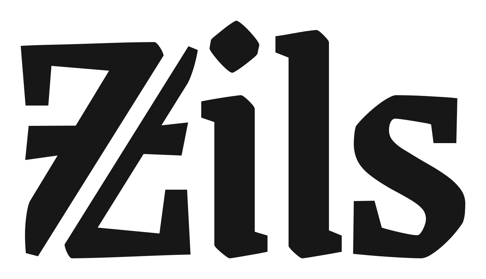

<h1 align="center">
  <a href="https://zils.ai">
    <picture>
      <source media="(prefers-color-scheme: dark)" srcset="docs/assets/zils-logo-dark.svg">
      <source media="(prefers-color-scheme: light)" srcset="docs/assets/zils-logo-light.svg">
      
    </picture>
  </a>
</h1>

**Miner and validator software for Zils decision-model training.**

Miners train candidate models. Validators verify their artifacts, calibrate
probabilities, evaluate held-out examples, and compute miner scores. This
repository contains those workers, their shared model and protocol contracts,
and the Bittensor subnet integration (mainnet subnet 127).

## Start here

| Role | Guide |
| --- | --- |
| Mine on mainnet subnet 127 | [Mining on Zils](docs/mining.md), starting with [registration](docs/bittensor-registration.md) |
| Commit soup bodies | [Soup pool](docs/mining.md#soup-pool) |
| Train customer jobs on NVIDIA hardware | [Customer-job miners](docs/queue-miners.md) |
| Run a validator | [Validator setup](docs/validators.md) |
| Develop or evaluate the subnet | [Local development](docs/development.md), [evaluation contract](docs/evaluation.md) |

Mainnet subnet 127 has been live since 3 November 2026. Registering a hotkey on
127 is the admission; there is no application or operator approval. Under the
launch configuration (`zils/data/base-pools-launch.json`) miners earn two ways,
paid from one weight vector:

- **Soup pools (80%).** Four pools, one per z3 size: z3-lite 0.8B and z3-mini
  4.5B are open, z3-flash 8.4B and z3 26B open later and burn their share until
  then. A miner uploads a fine-tune to Hugging Face and commits it on chain with
  `zils-miner commit-body`. Each round, validators average the best bodies into
  a soup and pay its five seats and one crown.
- **Customer jobs (20%, the adapter track).** A registered miner claims customer
  training jobs from the hosted queue with `python -m miner.queue` and is paid
  from paid API use of the open-tier adapters it delivered.

Anything unearned burns to the subnet owner's uid. Start with
`curl -fsSL https://zils.ai/install.sh | sh`; it installs the stable release and
`zils-miner`. `zils-miner` never assumes mainnet: run
`zils-miner setup --network finney --netuid 127` once and later chain commands
use what it saved.

## Repository scope

| Repository | Owns |
| --- | --- |
| **zils** — this repository | Miners, validators, training, evaluation, model integrity, signed protocols, chain weights |
| [zils-platform](https://github.com/ooo-hq/zils-platform) | Hosted APIs, account/billing logic, storage, database migrations, queue orchestration, serving |
| [zils-sdk](https://github.com/ooo-hq/zils-sdk) | Python/TypeScript clients, CLI, MCP |
| [zils-web](https://github.com/ooo-hq/zils-web) | Website, playground, customer dashboard |
| [zils-docs](https://github.com/ooo-hq/zils-docs) | Public documentation site (`docs.zils.ai`) |

Platform and SDK repositories may require organization access. Miner setup does
not require either repository, a payment SDK, or a Supabase service credential.
The platform uses this repository's evaluation code as a dependency. See
[repository boundaries](docs/repositories.md) for the split and migration details.

## Miner setup

Soup miners follow [mining](docs/mining.md#install). Customer-job miners follow
[customer-job miners](docs/queue-miners.md) to install the stable release, qualify
the host and write a private hotkey configuration. Then, from the install:

```sh
export ZILS_D3_RUNTIME_PYTHON="$PWD/.venv-d3/bin/python"
.venv-kev/bin/python -m miner.queue \
  --config .private/queue-miner.json --state .private/queue-miner \
  --reference models/d3-reference --device cuda
```

z3 training requires CUDA. The worker uses outbound HTTPS and receives only
training data and signed upload URLs. Keep calibration/test data and operator
service credentials off miner accounts. For a closed development fleet, run
`./start-miner --rounds 1` from its assigned bundle after completing the
[fleet guide](docs/mining.md#closed-development-fleet).

## Validator setup

Follow [validator setup](docs/validators.md) to configure the correct workflow.
A configured Bittensor validator evaluates one round with:

```sh
.venv-kev/bin/python -m zils.fleet validator \
  --config .private/testnet-fleet/validator/config.json --rounds 1
```

This previews weights without publishing. Chain submission remains a separate,
explicit step. Validators check model hashes, allowed tensors, calibration,
held-out quality, and registered identities. A valid training run can produce
`no_qualifying_model`; miners are not guaranteed acceptance.

The hosted queue processor lives in zils-platform and calls the same evaluation
code. Its deployment and database access are separate from miner installation.

## Setup

### Repository setup

Install Git, Python 3.13, and `uv` on macOS, Linux, or WSL 2:

```sh
git clone https://github.com/ooo-hq/zils.git
cd zils
uv venv --python 3.13 .venv-kev
uv pip install --python .venv-kev/bin/python \
  -r requirements/model.txt -r requirements/rehearsal.txt
.venv-kev/bin/python -m scripts.download_models
```

`scripts.download_models` fetches the small Kev 0.8B reference that the CPU
examples in [development](docs/development.md) use. For z3, follow
[customer-job miner setup](docs/queue-miners.md#2-install-the-stable-release).
References are downloaded from pinned upstream revisions. Private
checkpoints, wallets, datasets, and generated bundles are excluded from Git.

## Development

Install the [development dependencies](docs/development.md), then run:

```sh
make check
```

Checks exercise workers, signed submissions, evaluation, and chain behavior
with local fixtures. They need no live chain or hosted account. Optional GPU
checks are explicitly gated. Node.js and hosted database services are not
needed for this repository's checks.

## Results and limits

The [first verified testnet round](docs/testnet-round-001.md) (25 September 2026)
is recorded evidence, not a statement of current subnet admission or uptime. [Experiment reports](docs/experiments.md)
and the [public JevBench comparison](docs/jevbench-public.md) preserve results,
including regressions. Synthetic fixture tests establish behavior, not model
quality, hostile-checkpoint isolation, or production capacity.

See [documentation](docs/README.md), [open milestones](docs/roadmap.md), and the
[public model page](https://zils.ai/model).
